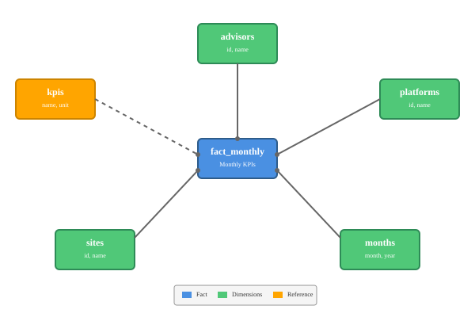

# Installation

- Must be installed on the same database server as sims3.
- Sims3 database name must be set in .env DB_DATABASE_SIMS3

```
composer install
php artisan migrate:fresh --seed
php artisan sims3:import-dimensions
```

# Data model

This BI database implements a **star schema** (also known as star model), which is the industry standard for data warehouse design.

## Why Star Schema?

The star schema is the optimal choice for business intelligence and analytical workloads because:

- **Simplified Queries**: All dimension tables connect directly to the fact table, making JOIN operations straightforward and performant
- **Historisation** : We keep the history of the fact. For example : advisor and facts are directly linked so we can see in the data "for C1, advisor XXX was in charge in 2021 but it was YYY starting in C2" When you use a normal relational schema with advisor behind site, when advisor is reassigned to another site it applies to all past data.
- **Fast Aggregations**: Fact tables contain only measurements and foreign keys, optimized for rapid aggregation of large datasets
- **Intuitive Structure**: Business users can easily understand the model without deep technical knowledge
- **Scalability**: Handles millions or billions of fact records efficiently while keeping dimension tables relatively small
- **Standard**: You can plug this database as it is with PowerBI or Tableau or any BI tool, it will immediately work

## Architecture

The star schema consists of a central **fact_monthly** table surrounded by **dimension tables** (sites, advisors, platforms, months):



## Tables

### Fact Table

**`fact_monthly`** - Monthly aggregated metrics per site. One column per KPI.

| Column         | Type        | Description                              |
| -------------- | ----------- | ---------------------------------------- |
| id             | integer     | Surrogate primary key                    |
| site_id        | foreign key | → sites.id                               |
| platform_id    | foreign key | → platforms.id                           |
| advisor_id     | foreign key | → advisors.id                            |
| month          | date        | Reporting month                          |
| tier           | string      | Site classification tier                 |
| sales_volume   | integer     | Sales volume (excl. WiS)                 |
| days_open      | integer     | Operating days count                     |
| expenses       | integer     | Total expenses                           |
| revenue        | integer     | Total revenue                            |
| workers        | integer     | Number of workers                        |
| consumers      | integer     | Consumer count                           |
| who_compliance | boolean     | WHO compliance status                    |
| profitable     | boolean     | Profitability flag (P&L + Salary >= 200) |

### Why one column per KPI ?

Initially it was planned to have only one column "value" and a column "kpi_id" to know which KPI it was about. Here the reasons why it was a terrible idea :

- The type of the column "value" would have been problematic. It can be int or float or boolean or even text.
- The simplest calculations would have been very difficult. For example if you want to do (sales-expenses) we would have needed ao do a self join on a multi million lines table. With one column per KPI you can just do it directly. It will reduce the number of KPI as it doesnt make sense to pre-calculate KPIs when there are just a simple addition of 2 existing Kpis.
- The performance would have been exactly the same. The table is much bigger with one col per KPI but as we always use SELECT xxx, useless data is never in the query
- Standardisation : current schema can go out of the box to common BI tools without any change

KPIs is now a simple metadata table to describe KPI (the unit, the periodicity, the name). One of this metadata is the name of the column containing this KPI data in the fact table.
